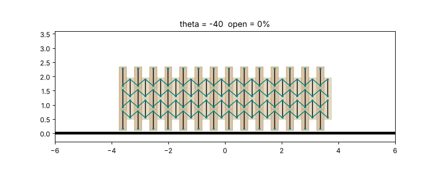
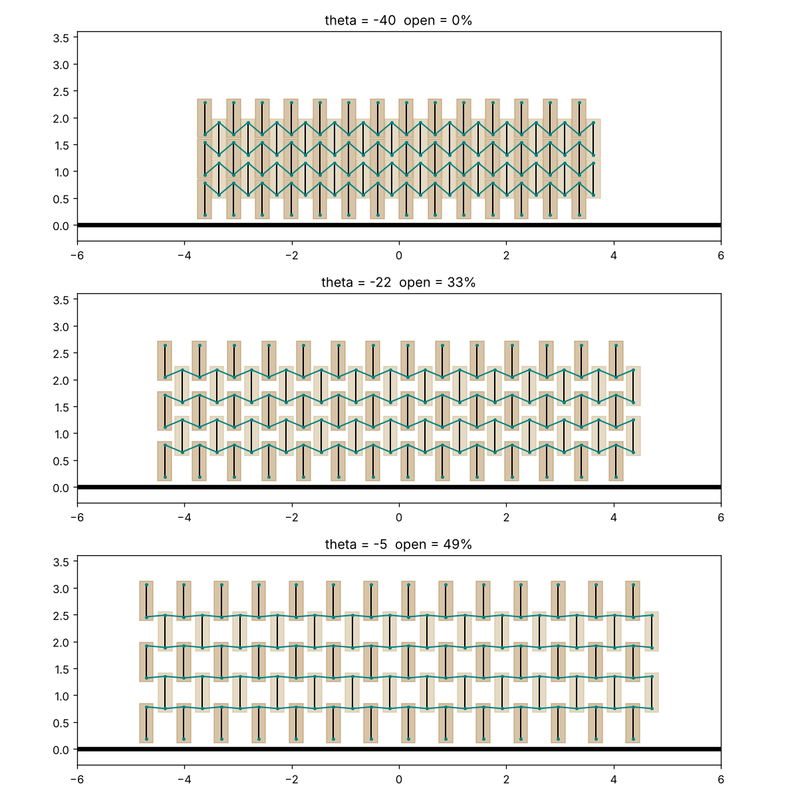

# reentrant honeycomb shading

An auxetic overhang for a gallery facade using a reentrant honeycomb. One actuator straightens the bowtie cells, system grows along the wall and out from it at the same time (negative Poisson's ratio). Plates on the straight ribs spread apart to allow 50% canopy opnening.



## run

```
pip install -r requirements.txt
python reentrant_honeycomb.py
```

or open `reentrant_honeycomb.ipynb` in Colab (upload `reentrant_honeycomb.py` too)

## current numbers (default inputs)

- 14 x 5 cells, h = 0.6 m, l = 0.35 m, theta -40 to -5 deg
- rib lengths don't change over the motion, so it's a real mechanism
- poisson's ratio -0.85 to -7.0 (matches Gibson & Ashby)
- width 7.5 -> 9.8 m, depth 2.3 -> 3.1 m
- 0% -> 49% open



## todo

- [ ] structural model (ribs as beams, dead + wind uplift, moments, actuator force)
- [ ] sun position + shadow on the glass
- [ ] controller to pick the opening through the day
- [ ] 3d animation for the boards

## ref

Gibson & Ashby, *Cellular Solids*, 2nd ed., 1997
